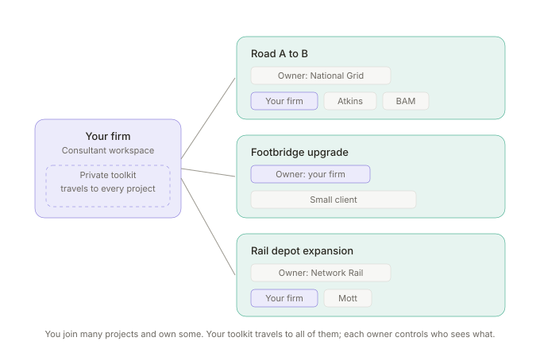
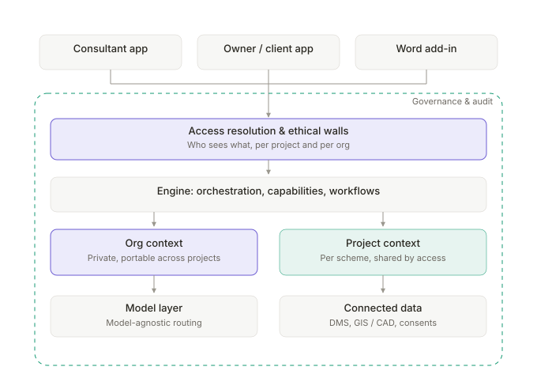
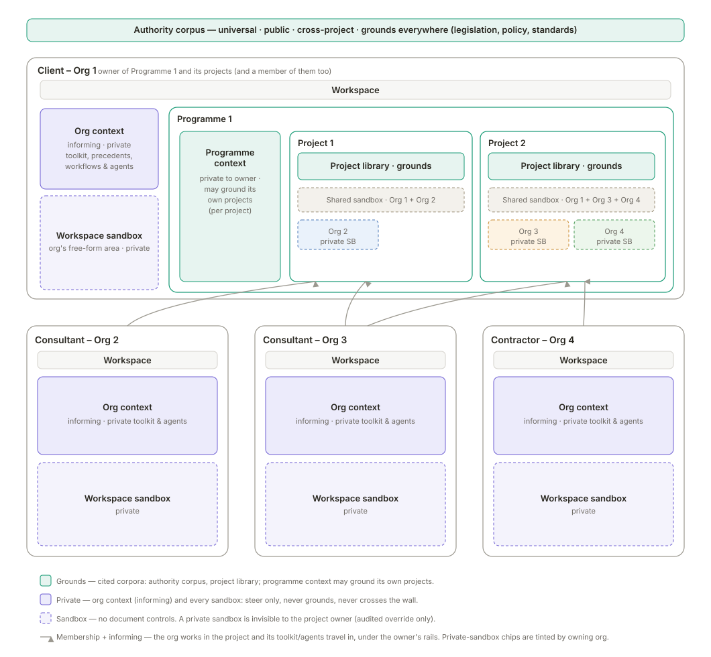
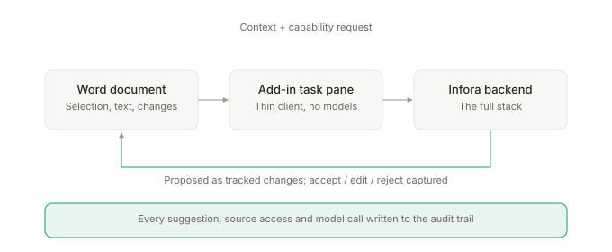

# Infora — Overview

Infora is a vertical agentic operating system for planning and construction. 

This is the whole-system overview — what Infora is and is for, the bet behind it, the architecture of the software, the features it delivers and the components it is built from, and how the code is laid out to enable it. Features (what Infora does) and components (how it is built) are two lenses on the same system, both set out below.

---

## What Infora is

Infora takes the shape of a vertical agentic OS.

Infora gives teams the system they need to store their information, collaborate and leverage AI in a seamless environment where multiple organisations can function together. 

Infora is a **network**, organisations work through its **workspace** across many projects, owns some and joins others, and carries a private, portable toolkit — its **context** — everywhere it goes. **Owner** is a per-project role that a client or a consultant can hold. What Infora *does* is set out below as a set of **features**, and how it is *built* as a set of **components** — two lenses on the same system.

## The problem Infora is solving

Major planning and construction projects run on documents — thousands of them, produced and reviewed across many organisations over years. Producing them is slow, repetitive and error-prone, and the bottleneck is structural: it is the way production is organised, not the calibre of the teams or the tools they hold. Three causes compound.

**Process — production is sequential, and context is rebuilt at every step.** Learn the project, read the documents, first draft, second draft, senior check, client review, redraft. Every handoff is a place errors enter, and every person begins by rebuilding the context the last one already had.

**Information — project knowledge is fragmented, with no intelligence layer over it.** It lives across CAD, GIS, document management, email and individual heads, and nothing sits above it. Specialists spend weeks gathering inputs before drafting even begins.

**Expertise — the scarce resource is spent on the wrong work.** Specialist judgment is the limiting input, yet it is consumed by building context and drafting from scratch rather than by the judgment only an expert can give. The constraint is misallocation, not supply.

Together these make expert time the bottleneck on every project — doing work that should be automated and not staffed.

**And the industry cannot capture AI's value on its own.** The bottleneck above is exactly the kind of problem AI should dissolve — yet adoption across planning and construction is low, and not for want of technology. Firms hold frontier-model subscriptions but no way to point them at their own projects: the models have no access to the project's documents, no grasp of the domain's governance, and nowhere to live inside the multi-organisation structure a scheme runs through. So pilots stall, value never compounds, and teams fall back on the sequential, manual process above.

Other sectors show the shape of the answer: a vertical platform, not another model. Legora gave law firms a system to run AI over their own matters; Palantir gave HS2's EKFB delivery joint venture a platform to unify fragmented project data and build their own operational tooling on top of it. In each case the unlock was not a smarter model but a system that put AI where the work and the data already were, with the governance the sector demands.

Planning and construction has no such platform. That is the gap Infora fills — first by doing the document-production work itself (the wedge), then by becoming the layer on which firms build and run their own AI for the sector (the long-term vision).

### The wedge and the long-term vision

The **wedge** is AI-driven document management and AI document production: agents that accelerate the manual production and review tasks a project already has — drafting sections or whole documents, running assurance, analysing documents to generate other outputs — inside the controlled project environment. It is sticky because project knowledge and the AI compound the longer a project runs: the more a team works in Infora, the better its per-project knowledge, its codified workflows, and its per-document guidance get, so output improves with use. That "gets better the more you use it" is knowledge, workflows and guidance compounding behind the interface and improving the prompts and guardrails per document.

The **long-term vision** is Infora as the platform on which consultant and contractor firms build their *own* AI tooling for planning and construction — a build-your-own-agentic-systems layer, the sector's analogue to a "Legora-OS." Org-built agents and custom workflows live in the firm's portable org context and deploy to any project it works on. The aim is the one-stop shop: a firm runs its agentic systems on Infora rather than holding several separate frontier-model enterprise accounts. The wedge earns the right to the vision; the vision is why the wedge compounds into a platform rather than a point tool.

---

## The overarching emerging architecture

Two views of the same system: the network model (who relates to whom) and the app architecture (how the running system is organised). How the code is laid out is a build-facing concern and lives in the build layer, not here.

### 1. The network model

An organisation acts through its **workspace**. Each **project** is a shared space with exactly one **owner** organisation and other organisations as **members**. A **programme** groups projects under a single owner. The owner controls what is shared; **ethical walls** isolate members from each other. **Org context** is private and portable; project context is shared by access.

### 2. The app architecture

The running system. Every surface passes through the **access layer**, which resolves identity, project role, ownership, and ethical walls before anything below is touched. The engine assembles one working input from the context stores per request — the requester's own private stores (org, and programme if it owns the programme) plus the access-resolved project slice. Governance and audit wrap the lower layers. *(For brevity this diagram draws context as two boxes; the full three-store topology — org, programme, project — is the figure that follows, detailed in [component-4-context.md](component-4-context.md).)*

The three context scopes in full — org (private, portable), programme (private to a programme owner) and project (shared by access) — and which may ground:

The code layout — the monorepo and its packages, the dependency rules, and the data model behind them — is build-facing and evolving, so it lives in the **build layer** ([docs/build/](../build/)) rather than in this solution overview.

---

## What Infora does — the features

**Features** are what Infora does — the product view, in the language a customer would recognise. **Components** (the next section) are how the software is structured to deliver them — the build view. The mapping between the two is many-to-many: one feature spans several components, and one component serves many features, so the two are set out as separate lists rather than forced into one.

### AI workflows (standard)

The governed, agentic end-to-end processes Infora ships. **Document production is the flagship** — agents draft sections or whole documents from the project's own sources, grounded and cited, conformant to legislation, standards, policy, style guides and project guidance, with automated assurance and checking built in. Alongside it: assurance, consultation analysis, data interrogation, feedback triage and internal reports. A workflow is the governed process behind a work item; it is run by an agent, draws on reusable capabilities, and produces an audited run.

### Controlled document management

The full controlled-document lifecycle, and the substrate that makes the AI trustworthy. Teams draft freely in a sandbox; promotion snapshots a working copy into an immutable controlled revision; every deliverable is planned up front as a coded container. The **human review-and-assurance cycle** runs on the PDF in a native viewer — anchored comments, two-level acceptance coding, one live append-only review record (the DRR) per deliverable, and transmittal as an on-platform event. Accepted deliverables enter the project library, the curated corpus the AI grounds on.

### Build-your-own workflows & agents (custom)

Organisations build their own workflows and agents, held in their private, portable org context and deployable to any project they work on. This is the build-your-own-agentic-systems layer of the long-term vision, and a reason to adopt Infora independent of any client mandate. A deployed custom workflow runs exactly as an Infora-built one does — same engine, same governance envelope, inheriting the project owner's rails — differing only in provenance and deployment.

### Project chat / Ask

Conversational, grounded question-answering over a project: ask anything and get cited answers, navigate the library, and understand the scheme. Distinct from a workflow in that it is interactive and exploratory — it produces answers, not controlled deliverables — though a quick draft can start here before moving into the document lifecycle. Reachable both in Infora's own surfaces and from inside **Microsoft 365 Copilot** by tagging `@Infora` (a read-only Ask surface, bound to one project per conversation — see Surfaces).

### Cross-organisation collaboration

Many organisations working together on one project under a single owner, with controlled sharing and **ethical walls as the standing default**: by default each organisation sees only its own work, what the owner has shared with it, and the shared spaces it has joined. The owner opens cross-organisation visibility deliberately. This is the user-facing face of the access model.

### Compounding knowledge

Infora captures how an organisation's experts work — the **Signals** from accepting, editing and rejecting AI output — and feeds them back as retrievable knowledge, codified workflows and per-document guidance, so output improves the more the platform is used. Improvements accrue to the organisation's own context and are never shared across customers. This is the moat, and the user-facing face of the context layer.

### Spatial & model referencing *(later)*

Reading and referencing spatial and model data — GIS, CAD, BIM — by reference rather than through the controlled-document lifecycle. Deliberately deferred until the wedge is proven.

---

## How Infora is built — the components

The buildable units the software is structured into — the build view. **This is an evolving cut**: it captures the current understanding and is expected to firm up, and shift, as the build proceeds and the build layer (`docs/build/`) is written. Note what is *not* a component: reusable **capabilities** (skills), **workflows** (the recipes) and **chat** all live *inside* the Engine; **access** and **governance** are cross-cutting concerns enforced at the boundary, not feature areas.

### Foundation

The shared base every other component stands on: the model-agnostic **router** and provider adapters (so the model is rented and swappable), the **store substrate** (Postgres + pgvector, with vectors co-located beside the relational access data), and the **typed contracts** that are the single source of truth for the API. Depended on by everything; depends on nothing.

### Access

Resolves who can see and do what — organisation Membership (the ceiling), per-project role, ownership, per-deliverable Participant grants, and ethical walls — at the boundary, before any data is touched. Every request passes through it, and nothing below resolves its own permissions.

### Governance

The cross-cutting trust layer that makes autonomy defensible: the **audit trail** of every agent, user and system action; **grounding** and citation checks that can withhold unsupported output; **rails** (register, negative constraints, confidence calibration) with an owner-set, member-tightenable authority model; and the security posture (SOC 2, Cyber Essentials, G-Cloud, GDPR). It wraps every other component rather than sitting beside them.

### Context

The knowledge substrate and the moat. Holds the three scoped stores — **org** (private, portable, informs only), **programme** (private to a programme owner), **project** (shared by access) — the three channels (grounded, guiding, informing), per-channel retrieval and per-request assembly within a single assembly environment, and the signal/distillation loop by which knowledge compounds. It also holds the universal **authority corpus** (legislation, policy and standards, maintained Infora-wide and citable directly). It grounds on the project library but does not store it (document management does).

### Document management

The controlled-record engine: coded **containers** and immutable **versions**, the native and PDF **renditions**, the **deliverable plan**, the **DRR** and its acceptance coding, **transmittal**, the records lifecycle (supersede / withdraw), and the **project library** the AI grounds on. The unglamorous CDE basics that let everything above be trusted.

### Engine

The execution machinery — the thing that actually does the work. **Orchestration** plans and routes work across agents and sub-agents; **agents** (Infora-built or org-built) carry out the steps; the engine runs the **workflows** (standard and custom recipes), calls the **capabilities** (grounded generation, compliance checking, chat/QA, tabular review, plain-English, …), and produces the **run** — the audited record of every step. The orchestration / run / agent model is settled (ADR-0028): every execution is a Run inside a Conversation, decomposing into an append-only tree of steps run by parallel-capable sub-agents.

### Connectors *(deferred)*

Integrations that bring external data in — incumbent document management systems, and later GIS, CAD and BIM read by reference. Deferred until the wedge is proven, but the boundary is reserved.

### Surfaces

The interfaces where people and agents meet the system: the workspace and project home (with the left nav rail — Home, Ask, Editor, Documents, Review, Sandbox, Tools, History; Knowledge staged with the moat slices; Workflows renamed Tools 2026-07-13, T-109 — a *tool* is the packaged capability a user launches, a *workflow* the codified sequence it runs), the **Ask/chat**, the editor, the document-management and PDF-review views, the owner/client portfolio (the "control tower"), the **Word add-in**, and the **Microsoft 365 Copilot integration** (tag `@Infora` in Copilot to reach the Ask chat agent — a thin external surface, one project per conversation). Every surface is a thin client over the single typed API, so new surfaces add without divergence and inherit orchestration, context, governance, audit and access scoping.

**Knowledge (the rail section) is the context layer's surface** — everything that shapes work but is not the controlled record (agreed 2026-07-06). In a project it holds four things: **sources outside the library** — ingested material that is not a library document; channel retrieval never pulls it automatically, though a user may hand one to the agent for a single generation as an **attached source** (ADR-0022), and standing groundability comes only when the owner admits it to the library (which itself holds both project-produced deliverables and owner-acquired third-party material, ADR-0011); **guiding material** — the project's templates, style guides and guardrails (the guiding channel, ADR-0021); **distilled Knowledge** with its Signals and the improvements derived from them (the compounding layer — Sessions 4/7, post-MVP); and the **authority shelf** — the universal authority corpus of legislation, policy and standards, browsable and citable, licence-gated, Infora-maintained rather than project-uploaded (ADR-0023). In the workspace the same section becomes the organisation's own toolkit: precedents, firm know-how, and the curation queue through which material is admitted to portable org context (ADR-0026). Surface placement does not set channel role (ADR-0021): the authority shelf is a **grounded corpus** — an answer about, say, noise-insulation risk grounds on and cites the Regulations as external authority exactly as it cites the project's noise assessment as project fact — so the grounded channel's two corpora simply live on two surfaces: the project's own record under **Documents**, the external authority under **Knowledge**. The rest of the section steers or waits: guiding material steers and is never cited; a source outside the library never enters channel retrieval, but a user may pin it to a single generation as an **attached source** — the agent draws on it and the output is badged user-supplied rather than cited as grounded fact (ADR-0022), with owner admission to the library the only route to standing groundability; distilled Knowledge powers answers but cites through to a grounded source, never standing as the citation itself.

> The detailed per-area docs alongside this overview (`component-N-*.md`) predate this features/components split and are being reconciled to it; until then, treat the two lists above as the current cut.

---

## The Word add-in (surface highlight)

The Word add-in is a **surface** — specifically the consultant authoring surface — and a strategically important one, so it is called out here. Through it, AI document production happens inside Word itself, the tool consultants already use.

It is a **thin client**: a task-pane web app (Office.js plus a manifest) with no intelligence locally, calling the same API as every other surface, so it inherits orchestration, context, capabilities, governance, audit and access scoping. On open it resolves which project the document belongs to. Its job is **governed editing**: agent changes land as native Word tracked changes carrying a citation and rationale, never silent rewrites; the user accepts, edits or rejects using Word's own review controls, and that resolution is the **Signal**. It is a consultant authoring surface, not a reviewer capture path (reviewers comment on the PDF in Infora's own viewer), so it does not capture review comments in build 1. Deployment is a GTM lever: Office add-ins push centrally through the M365 admin centre, so an owner can roll Infora out to every appointed consultant at once.

